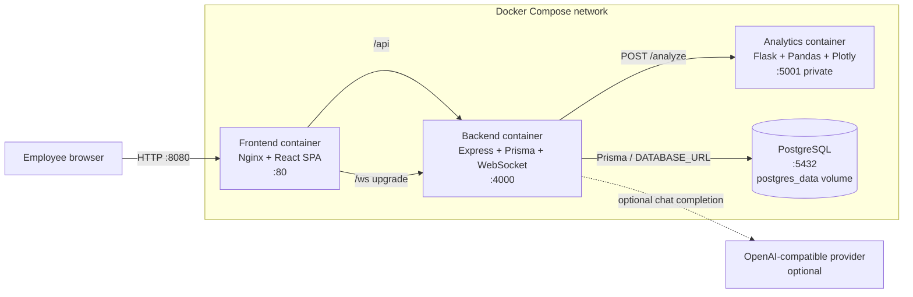
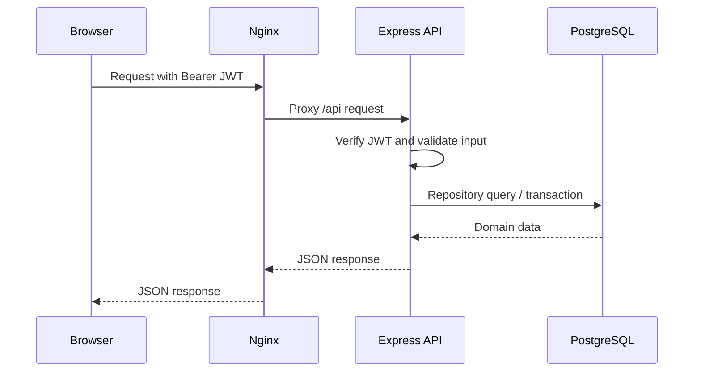
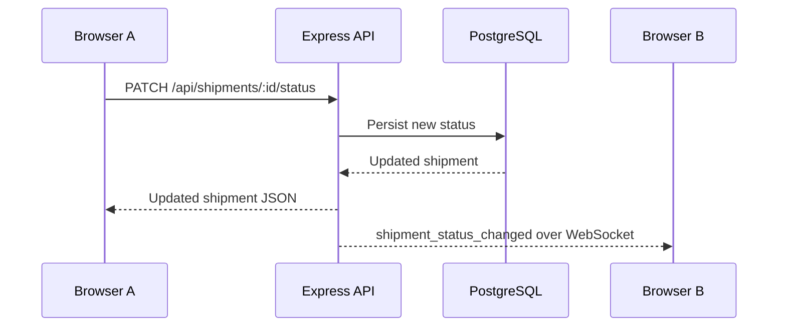
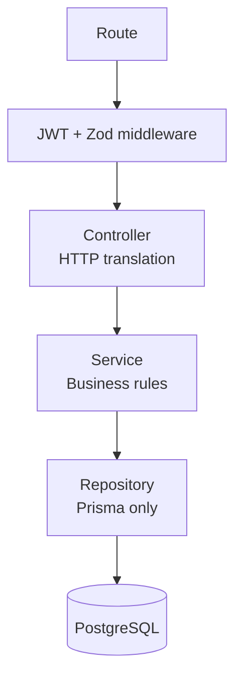

# System architecture

## Overview

The platform is a full-stack shipment management application. The browser talks to the React frontend through one public origin. Nginx serves the compiled SPA and reverse-proxies REST and WebSocket traffic to the Express API. The API owns authentication, business rules, persistence, real-time events, analytics orchestration, and chat orchestration.

## Local Docker architecture

### Runtime responsibilities

| Component | Responsibility | Public exposure |
|---|---|---|
| React + Nginx | Serves the SPA, handles client-side routing, proxies `/api`, `/api-docs`, and `/ws` | `localhost:8080` |
| Express API | JWT login, validation, customer and shipment rules, dashboard, chat, analytics proxy, WebSocket server | `localhost:4000` and through frontend |
| Prisma | Typed database access and migrations for the API | Internal to backend |
| PostgreSQL | System of record for users, customers, shipments, and chat history | Internal; volume-backed |
| Flask analytics | Validates CSV files and returns summary statistics plus Plotly figure JSON | Internal only |
| AI provider | Optional assistant completion; the API falls back to demo mode when unavailable | Outbound from backend |

## Request flows

### Authenticated REST request

### Shipment status notification

WebSocket events are broadcast in-process. If the API is scaled beyond one instance, add Redis pub/sub, Azure Web PubSub, or Azure SignalR so every instance can fan out status events.

## Backend layering

This separation keeps HTTP concerns out of business logic and keeps Prisma access out of controllers and services.

## Production topology

The recommended Azure target is documented in [azure-deployment.md](azure-deployment.md). It replaces local Docker infrastructure with managed services:

- Azure Front Door and WAF provide TLS, routing, and edge protection.
- App Service hosts the API/frontend and the private analytics service.
- Azure Database for PostgreSQL replaces the local database volume.
- Key Vault stores connection strings, signing keys, and provider configuration.
- Application Insights and Log Analytics collect structured logs and health signals.
- Redis, Web PubSub, or SignalR is required for multi-instance WebSocket fan-out.
