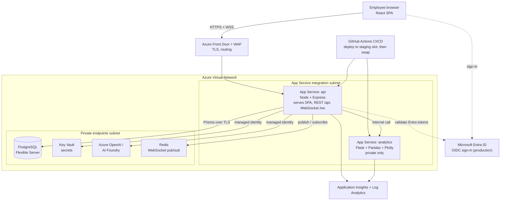

# Azure Deployment Design

> **Status: design only.** Nothing in this document has been deployed. Local development uses local PostgreSQL, a seeded user with JWT login (a mock of Entra ID), and Groq as an OpenAI-compatible model. Sizes and SKUs below are illustrative.

## 1. Architecture



**Key decisions**

- **One origin.** The Node App Service serves the built React app and the API (`/api`) and the WebSocket (`/ws`). This matches the Vite dev proxy, needs no cross-origin setup in production, and keeps one place to enforce authentication. *(Implementation note: the Express app does not serve `frontend/dist` yet. That is a small addition at deployment time, an `express.static` handler placed before the 404 handler.)*
- **Flask is private.** The analytics service has no public endpoint. Only the API reaches it, through VNet integration and a private endpoint, and the API enforces the JWT once (`POST /api/analytics/analyze` proxies to it).
- **No public database.** PostgreSQL Flexible Server is reachable only through a private endpoint inside the VNet.
- **Secrets never live in code or app settings as plain text.** They sit in Key Vault and are read through the app's managed identity.

## 2. Components

| Component | Purpose | Why this choice | Local equivalent |
|---|---|---|---|
| Azure App Service (Linux, Node 20+) | API + React build + WebSocket | Managed hosting, deployment slots, autoscale, built-in health check | `npm run dev` |
| Azure App Service (Linux, Python 3.10+) | Flask analytics | Same platform and pipeline as the API, private only | `python app.py` |
| Azure Database for PostgreSQL, Flexible Server | System of record | Managed backups and point-in-time restore, private access | Local PostgreSQL |
| Azure Key Vault | Secrets and keys | Central, audited, rotatable | git-ignored `.env` |
| Microsoft Entra ID | Employee sign-in | Single sign-on, MFA, conditional access, groups to roles | Seeded user + JWT |
| Azure OpenAI or AI Foundry | Chat assistant | Data stays in the tenant, managed identity auth | Groq (OpenAI-compatible) |
| Azure Cache for Redis (or Azure Web PubSub) | WebSocket fan-out across instances | See section 6 | In-process EventEmitter |
| Azure Front Door + WAF | TLS, routing, protection | Edge security, supports WebSockets | none |
| Application Insights + Log Analytics | Logs, metrics, alerts | One place for both services | pino logs in the terminal |
| VNet + NSGs + private endpoints | Network isolation | Keeps data services off the public internet | none |
| GitHub Actions | CI/CD | Repository is on GitHub | manual |

## 3. Security

- **Identity.** Production sign-in uses Entra ID (OIDC). The API validates the Entra access token (issuer, audience, signature, expiry) and maps app roles or groups to permissions. Local development keeps a real JWT and bcrypt flow against a seeded user, so replacing the identity provider does not change the rest of the API.
- **Service-to-service.** The API reaches Key Vault and Azure OpenAI through a system-assigned **managed identity** with least-privilege RBAC (Key Vault Secrets User, Cognitive Services OpenAI User). No keys are stored for these.
- **Secrets.** `DATABASE_URL`, `JWT_SECRET` (until Entra replaces it) and any API keys live in Key Vault and are referenced from App Service settings with Key Vault references. Nothing sensitive is in Git; `.env` is git-ignored and `.env.example` holds placeholders.
- **Network.** Public access is disabled on PostgreSQL, Key Vault, Redis and Azure OpenAI; they are reached through private endpoints and private DNS zones. Public ingress is only Front Door to the API. NSGs deny everything else.
- **Transport.** HTTPS only, TLS 1.2 minimum, WSS for WebSockets.
- **Application layer.** Helmet security headers, CORS restricted to the app origin, Zod validation on every request body, request size limits, a single error handler that never leaks stack traces, soft delete and audit fields (`createdBy`, `updatedBy`, `deletedAt`). WAF rules at Front Door. Rate limiting on login is a planned addition.
- **Data.** Encryption at rest is on by default. PostgreSQL has automated backups with point-in-time restore.

## 4. Configuration

| Variable | Source in Azure |
|---|---|
| `NODE_ENV` | App setting (`production`) |
| `PORT` | Provided by App Service |
| `DATABASE_URL` | Key Vault reference |
| `JWT_SECRET` | Key Vault reference (not needed once Entra validates tokens) |
| `JWT_EXPIRES_IN` | App setting |
| `CORS_ORIGIN` | App setting (the public host name) |
| `LOG_LEVEL` | App setting |
| `ANALYTICS_URL` | App setting (private address of the Flask app) |
| `OPENAI_BASE_URL`, `AI_MODEL` | App setting (Azure OpenAI endpoint and deployment name) |
| `OPENAI_API_KEY` | Not needed with managed identity; otherwise a Key Vault reference |

The application validates its configuration with Zod at startup and exits with a clear message if something is missing, so a bad deployment fails immediately instead of at the first request.

## 5. Deployment strategy

1. **Environments:** dev, staging and production, each with its own resource group, database and Key Vault. Production changes only come from `master`.
2. **Pipeline (GitHub Actions):** install, lint, unit and integration tests, frontend build, then deploy.
3. **Staging slot and swap:** the new version is deployed to a staging slot of the same App Service, warmed up and smoke-tested at `/health`, then swapped into production. Rollback is a swap back.
4. **Database migrations:** `prisma migrate deploy` runs as a pipeline step before the swap, never on application start. Because the database is private, the step runs from a runner inside the VNet (self-hosted runner) or through the App Service deployment tooling. Migrations follow an expand-then-contract pattern so the old and new versions can both run during the swap.
5. **Health and readiness:** App Service health check on `/health`; unhealthy instances are removed from rotation.
6. **Authentication to Azure from CI:** GitHub OIDC federated credentials, so no Azure secret is stored in GitHub.

### Illustrative workflow (`.github/workflows/ci-cd.yml`)

```yaml
name: ci-cd
on:
  push:
    branches: [master]
permissions:
  id-token: write
  contents: read
jobs:
  test:
    runs-on: ubuntu-latest
    services:
      postgres:
        image: postgres:16
        env: { POSTGRES_PASSWORD: ci, POSTGRES_DB: shipment_platform }
        ports: ["5432:5432"]
    env:
      NODE_ENV: test
      PORT: 4000
      DATABASE_URL: postgresql://postgres:ci@localhost:5432/shipment_platform
      JWT_SECRET: ci-only-secret-not-used-anywhere
      JWT_EXPIRES_IN: 1h
      CORS_ORIGIN: http://localhost:5173
      LOG_LEVEL: silent
    steps:
      - uses: actions/checkout@v4
      - uses: actions/setup-node@v4
        with: { node-version: 22 }
      - run: npm ci
        working-directory: backend
      - run: npx prisma migrate deploy && npx prisma db seed
        working-directory: backend
      - run: npm test
        working-directory: backend
      - run: npm ci && npm run lint && npm run build
        working-directory: frontend
  deploy:
    needs: test
    runs-on: ubuntu-latest
    steps:
      - uses: actions/checkout@v4
      - uses: azure/login@v2
        with:
          client-id: ${{ vars.AZURE_CLIENT_ID }}
          tenant-id: ${{ vars.AZURE_TENANT_ID }}
          subscription-id: ${{ vars.AZURE_SUBSCRIPTION_ID }}
      # build backend + frontend, deploy to the staging slot, smoke test, then:
      # az webapp deployment slot swap -g <rg> -n <app> --slot staging
```

## 6. Real-time notifications and scaling

The status-change event is emitted in process after the database update and broadcast to WebSocket clients by the same instance. With **more than one instance**, a client connected to instance B would not hear about a change handled by instance A. Options:

- **Redis pub/sub (Azure Cache for Redis):** every instance publishes the event to a channel and subscribes to it, then broadcasts to its own sockets. Simple and cheap; the service layer does not change.
- **Azure Web PubSub:** a managed service holds the connections; the API publishes to it. Best when connection counts grow.
- **Azure SignalR Service:** the equivalent with SignalR clients, a better fit for ASP.NET stacks.

Azure specifics: enable the **Web Sockets** setting on App Service; Front Door supports WebSockets; the platform closes idle connections after a few minutes, which the 30-second heartbeat already avoids; delivery is at-most-once, so clients refetch after reconnecting.

## 7. Observability

Application Insights for both App Services; structured JSON logs (pino) go to stdout and are collected in Log Analytics. Alerts on 5xx rate, response time and failed health checks. `/health` is also the uptime probe.

## 8. Reliability and cost

- PostgreSQL: automated backups with point-in-time restore; zone-redundant high availability for production.
- App Service: scale out on CPU or request count; at least two instances in production.
- Cost levers: Basic-tier App Service and a burstable PostgreSQL tier for dev and staging, scheduled shutdown outside working hours, a single Log Analytics workspace.

## 9. What changes between local and Azure

| Local (this repository) | Azure target |
|---|---|
| Seeded user, bcrypt, JWT | Entra ID (OIDC), token validation |
| Local PostgreSQL | PostgreSQL Flexible Server, private endpoint |
| Groq (OpenAI-compatible) | Azure OpenAI, configuration change only |
| In-process EventEmitter | Redis pub/sub or Web PubSub |
| Token in localStorage | httpOnly cookie or MSAL |
| Unique email blocks reuse after soft delete | Partial unique index where `deletedAt IS NULL` |
| `.env` file | Key Vault references |
