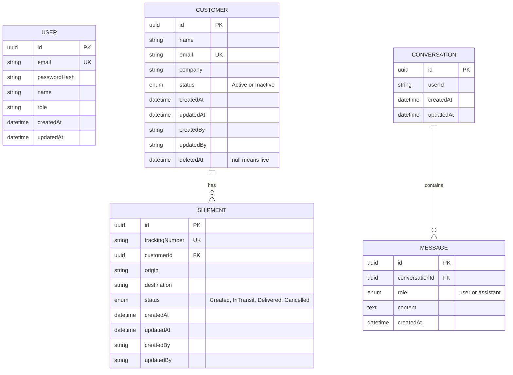

# Database schema

PostgreSQL, managed with Prisma migrations (`backend/prisma/migrations`). The schema source is `backend/prisma/schema.prisma`.

The database is the system of record for identity, customers, shipments, and persisted assistant conversations. Prisma generates the client used by the repository layer; application code does not issue ad-hoc SQL.

## Entity relationship diagram

`Conversation.userId` references `User.id` logically but is intentionally not a database foreign key. The same applies to `createdBy` and `updatedBy` audit fields. This preserves audit and conversation rows if an account is removed, at the cost of database-enforced referential integrity for those fields.

## Tables

| Table | Purpose |
|---|---|
| User | Login accounts. Passwords are stored as bcrypt hashes, never plaintext. One seeded demo user. |
| Customer | Customer records with a soft delete (`deletedAt`). |
| Shipment | Shipments belonging to a customer, with a status enum. |
| Conversation | One AI chat thread per user conversation. |
| Message | Individual chat messages in order. Deleting a conversation cascades to its messages. |

## Design decisions

- **UUID primary keys:** not guessable, and safe to generate in any service.
- **Enums for status and role:** invalid values are rejected by the database itself. Zod mirrors them at the API.
- **Soft delete (Customer only):** `deletedAt` is null for live rows. Deleting sets a timestamp, and every list query filters `deletedAt = null`. History and foreign keys are preserved and the row is recoverable. Shipments are not soft deleted; cancelling is a status.
- **Audit fields:** `createdAt` and `updatedAt` are automatic. `createdBy` and `updatedBy` hold the user id from the JWT. They are plain strings, not foreign keys, so audit history survives if a user is removed. The tradeoff is no database-level integrity on those columns.
- **Indexes:** `Customer.deletedAt`, `Shipment.customerId`, `Shipment.status` (dashboard grouping and customer lookups), `Message(conversationId, createdAt)` (history order).
- **Conversation.userId** is a plain string for the same reason as the audit fields.

## Known limitation

`Customer.email` is unique, so the email of a soft-deleted customer cannot be reused. A production fix is a partial unique index (`WHERE deletedAt IS NULL`).

## Migrations

`init` creates User, Customer and Shipment. `add_chat` adds Conversation, Message and the ChatRole enum. Apply with `npx prisma migrate dev` (development) or `npx prisma migrate deploy` (production). `npm run db:seed` loads the demo data.

In Docker, the backend startup command runs `prisma migrate deploy` and then the idempotent seed after PostgreSQL passes its health check. The Compose database uses the named `postgres_data` volume; `docker compose down` preserves it, while `docker compose down -v` removes it.
